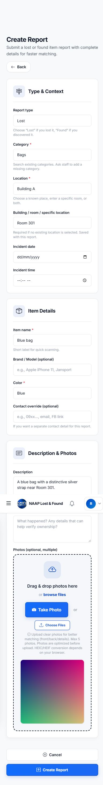
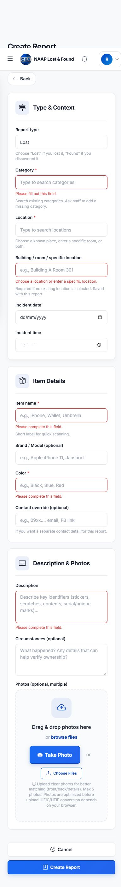
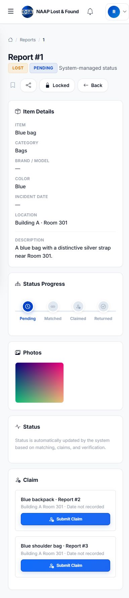
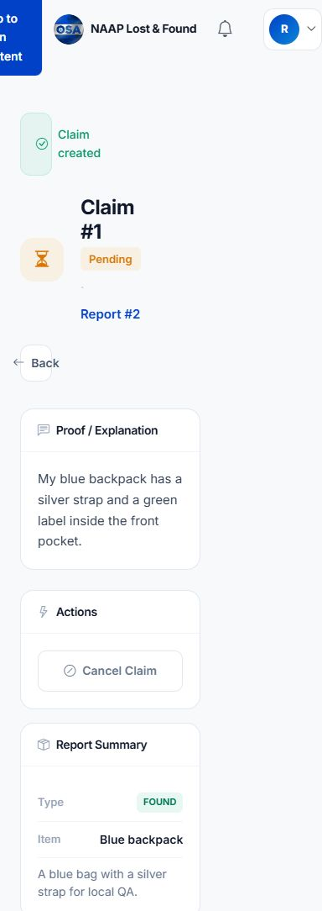
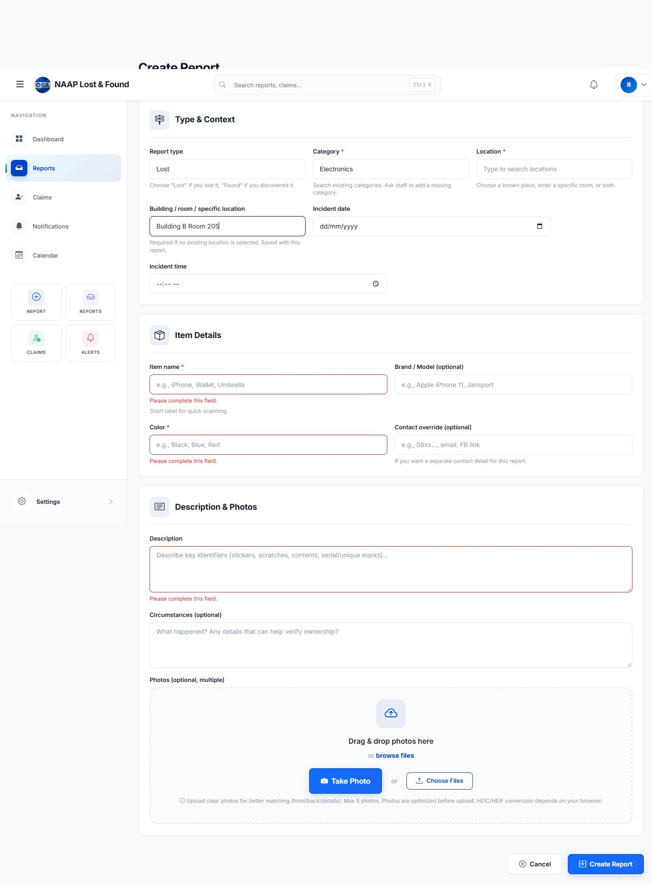

# Client deployment revisions — engineering report

Date: November 9, 2026 (Asia/Manila)

Branch: `revision/client-deployment-readiness`
Baseline: `f05017b`
Status: Implemented locally and regression-tested. No production deployment, production migration, production data changes, or push was performed for this revision.

## Architecture inspected

The installed stack is PHP 8.4.13, Laravel 12.48.1, Eloquent, Blade, vanilla browser JavaScript, Bootstrap 5.3.3/Bootstrap Icons, and Vite 7.3.1 with Tailwind tooling. No SPA framework or component library was introduced. MySQL-specific full-text matching exists in the application; automated tests use SQLite and the existing LIKE fallback. Production uses an attached S3-compatible bucket through `UploadedImageStorage`; local tests use fake disks. Existing GD compression, camera capture, profile/session isolation, custom notifications, claim eligibility, row locks, and submission UUID uniqueness were inspected and retained.

Relevant endpoints are `GET /reports/create`, `POST /reports`, `GET /reports/{id}/edit`, `POST /reports/{id}`, `POST /reports/{reportId}/photos`, `GET /reports/{id}`, `GET /claims/create/{reportId}`, and `POST /claims`. Existing admin and isolated-session route variants continue to use the same implementations. Category and location management remain staff-authorized. Existing API clients still submit category/location IDs; the additive field is `location_detail`.

## Revision 1 — searchable categories and detailed locations

**Cause:** Create/edit forms rendered ordinary selects. There was no per-report room field. Creating arbitrary master records from the report form would bypass the existing staff-only taxonomy rules and invite duplicates.

**Changes:** Shared Blade partial enhances the original selects into labeled native searchable datalist controls, preserving the fallback selects without JavaScript. Typing an exact existing option selects its ID; arbitrary category text is not accepted. Suggestions filter using native browser behavior and remain keyboard/mobile accessible. Locations support an existing ID, a detailed room, or both. For example, `Building A` plus `Room 301` displays as `Building A · Room 301`.

Custom rooms are report data, not new shared location rows. Whitespace is normalized. Detail text must be 2–190 characters, begin with a Unicode letter/number, and contain standard room-name punctuation. This prevents formula-leading values in exported location cells. Category/location IDs still pass integer/existence validation. No master category/location creation endpoint or permission was added.

The model's `location_label` is used in report details, lists, dashboards, manual match results, successful claims, calendar data, Excel exports, and PDF exports. Report templates dispatch change/input events so saved category names or IDs synchronize with enhanced controls.

**Database:** One additive nullable `item_reports.location_detail VARCHAR(190)` migration. Existing records/foreign keys remain valid; old records need no backfill. Rolling back removes only the new detail column, so newly entered room text would be lost on rollback. A rollback test checks that existing reports and relationships survive.

## Revision 2 — identifiable, consistent claim actions

**Cause:** The view had separate direct-found and lost-report claim blocks. The lost-report loop emitted repeated identical full-width “Submit Claim” buttons without identifying the associated found items. The old service returned unique IDs and the two branches were normally mutually exclusive: review did not establish duplicate database matches as the cause of those repeated-looking controls.

**Changes:** One rendering path now serves both views. Each eligible found item gets one card with its name, report reference, recorded location/date, available thumbnail, and exactly one item-specific claim link. No matching scores/methods are exposed to regular users. `ClaimEligibilityService`, authentication, authorization and transactional eligibility rechecks remain in force.

The claim form guards repeated submits, disables its button, shows a submitting state and resets safely after browser back/forward restoration. Ownership proof is trimmed (including Unicode whitespace) and limited to 20–5000 characters server-side. Server errors preserve proof text. Existing success redirects/messages remain. Existing report-row locking prevents concurrent duplicate claims; tests also check ineligible users, terminal states and repeat requests.

## Revision 3 — mobile photo compatibility

**Confirmed causes:** Backend rules were 4096 KB per image and a maximum 4000-pixel dimension, with no gallery optimization. A normal 4032-pixel phone photo could fail regardless of file size. The inspected Windows PHP configuration has `upload_max_filesize=2M`, `post_max_size=8M`, `memory_limit=128M`; server rejection can happen before Laravel sees the image. The “5 MB” report was not the actual report-upload limit in this code.

**Browser changes:** Sequential canvas resizing to a longest edge of 1600 pixels; JPEG encoding at 0.84, then 0.72/0.60 only if necessary; target <=1500 KB per prepared photo. Inputs accept JPEG, PNG, WebP and HEIC/HEIF. Browser-supported HEIC/HEIF decoding is converted to JPEG. Unsupported decoding produces explicit JPEG/Most Compatible guidance. No large HEIC/WASM dependency was added. PNG transparency is flattened onto white. Original selections survive failures; prepared bytes are cached for corrected retries. Selection across camera/gallery/drop remains cumulative and deduplicated to five. Object URLs replace base64 previews and are revoked; canvases are released after processing.

Source safety limits are 32 MiB and 48 megapixels, with at least 100×100 pixels. The same optimizer is used for create and add-photo flows. Field progress says which photo is being optimized, followed by “Saving report…”/“Uploading…”. HTTP 413 and non-JSON server failures get actionable messages.

**Server changes:** Shared `ReportImage` rule accepts actual JPEG/PNG/WebP image headers, maximum 10 MiB, minimum 100×100 pixels and maximum 20 megapixels. Corrupt/spoofed files are rejected. It estimates GD memory demand against the PHP memory limit before decoding. Raw HEIC is rejected with conversion guidance because this installation has GD and no Imagick/libheif decoder. Normal optimized browser output is far below these server bounds; original high-resolution files are not simply rejected under the old 4 MiB rule.

Single-photo uploads enforce the same validation and the five-photo cap while holding the report lock. Failure cleans up uploaded objects. The legacy controller entry delegates to that common path. Existing S3 object storage/signing behavior is unchanged. Small validated JPEGs already prepared to the target dimensions are not redundantly recompressed server-side; larger originals still use existing GD processing.

**Browser evidence:** At 390×844, an actual form submission with a synthetic 4032×3024 JPEG of 6,506,646 bytes succeeded; stored output was 1600×1200, 30,025 bytes. This is a simple gradient fixture padded to exercise large-file handling, not a real-photo quality/size benchmark. Real devices and HEIC files remain a staging/hardware acceptance task.

## Revision 4 — submission performance and reliable background work

**Confirmed blocking work:** `WebBaseController::notify()` used `DB::afterCommit()` to call `Mail::send()`. After-commit callbacks still run in the HTTP request, so multiple staff/match recipients add sequential transport latency. The image job implemented `ShouldQueue` but could run synchronously under `QUEUE_CONNECTION=sync`. Five server-side image decodes/encodes and S3 writes also occur in sequence. No evidence of duplicate frontend POSTs was found; the existing submission UUID and request guard were retained.

**Changes:** Notification rows remain synchronous and transactional. `DeliverNotificationEmail` persists a queued delivery job, with three attempts, backoff and a 30-second timeout. Database queue insertion occurs in the same transaction; non-database connections dispatch after commit. AI analysis is also queued durably from the report transaction. A `sync` queue setting resolves to a database background connection instead of calling AI or mail inline. AI has a 60-second worker timeout; its HTTP request has connection and response timeouts. Workers must be running on the selected connection.

Critical report/photo persistence, matching results, audit records and in-app notifications complete before the success response. Bounded keyword matching (20 candidates) remains synchronous so existing immediate eligibility behavior is preserved. Already optimized browser JPEGs avoid redundant GD work. Account/report locks and UUID-based report deduplication are unchanged. The response includes `Server-Timing` entries for report, photos and matching; structured logs contain timings/report ID, not report text or image contents. “Report submitted successfully” is flashed only after successful save.

### Measurements

The repeatable test performs one warm-up plus five timed Laravel HTTP requests, each with five 2000×1500 JPEGs and three staff recipients. Email transport is an array mailer with a controlled **200 ms delay per email**. SQLite/fake local disk are used; AI credentials are explicitly disabled. There are no opposite-type matching candidates in this fixture.

| Metric | Before (`f05017b`) | Final implementation |
|---|---:|---:|
| Samples, milliseconds | 1329.80, 1384.62, 1325.37, 1361.89, 1351.57 | 717.06, 717.69, 732.23, 739.12, 724.85 |
| Median | 1351.57 ms | 724.85 ms |
| Median query count | 24 | 23 |

The measured reduction is about **46% in this controlled scenario**, primarily the removed 600 ms of request-side mail latency. Queued mail still takes that time in a worker. Raw samples and conditions are in [performance.json](revision-evidence/performance.json).

The client's **15–20 second production behavior was not reproduced or measured**. These numbers exclude real S3, public network transfer, device processing, populated MySQL matching and external AI latency. They do not prove a six-second production SLA. A staging run with comparable photos/devices and the new timing logs is required to establish that target.

Reproduce after implementation in PowerShell:

```powershell
$env:RUN_REPORT_BENCHMARK='1'
php artisan test --filter=ReportSubmissionBenchmarkTest
Remove-Item Env:RUN_REPORT_BENCHMARK
```

## Revision 5 — mandatory item details

**Cause:** Backend rules allowed null item name/category/color/location; corresponding form inputs were not required. The only mandatory descriptive item field was the description.

Required now: item name, existing category, color, description, and either a selected location or detailed location. Found reports continue to require the recorded finder/reporter name, with existing staff/student-surrender rules preserved. Item name is 2–190 characters, color <=60, description 10–5000. Brand/model, contact override, circumstances, incident date/time and photos remain optional. Color can be “Multicolor” or “Unknown” when that accurately describes the item; no brand or contact is invented.

Both create/edit use the same FormRequest. Whitespace-only input, invalid IDs and wrong data types cannot bypass server validation. Unsafe array values produce validation errors rather than trim/type errors. Browser invalid events mark fields and provide inline messages; server messages map back to the searchable controls. Form entries and original files survive AJAX validation/network failures. No validation was removed to make tests pass: older successful submission fixtures were explicitly completed with the newly required fields.

## Verification

- **148 PHP tests passed, 643 assertions.** One opt-in benchmark is skipped in ordinary runs; it separately passed with six requests.
- **17 JavaScript tests passed.** Includes optimizer cleanup/cache/error paths, HEIC decoder failure, oversize pixel/count limits, pending-submit guard, camera-file transfer and prepared `photos[]` submission.
- PHP syntax checks passed for all changed/new PHP files. Pint passed for the eight newly authored PHP files. Existing files were not reformatted wholesale. No PHPStan/Psalm or ESLint configuration exists in this repository; this is not a claim of exhaustive static analysis.
- Vite production build passed. Its existing empty application-JS-chunk notice remains; the application loads public vanilla-JS assets.
- `git diff --check` passed.
- Regression coverage includes report UUID retries, authenticated ownership, locked reports, claim authorization/duplicates, approved claims, S3 signing/storage, photo validation/count, normalized room display, migration rollback, queue persistence and worker-only email delivery.
- Local browser checks passed at **390×844** and **1440×1000** with no horizontal page overflow. Search selection mapped back to the correct IDs. Custom-only `Building B Room 205` was valid without a master location. Empty submission stayed on the form and showed inline field errors. The large-photo report saved; two distinguishable match cards displayed one action each; selecting the first saved a claim against the correct found-report ID and authenticated user.
- Testing used a separate `storage/framework/testing/report-ui.sqlite` database and synthetic accounts/files. Production and the existing local application database were not used for browser fixtures.

Evidence:







## Deployment readiness and remaining limits

Implementation is ready for **staging acceptance**, not an unconditional production certification.

1. Apply the additive migration in the normal release process. No production migration has been run.
2. Configure a durable background queue and supervise its worker. Example: `REPORT_BACKGROUND_CONNECTION=database` and `php artisan queue:work database --queue=default --tries=3 --timeout=65`. Keep the database queue's retry-after greater than the worker timeout (the existing default is 90 seconds). If using Redis/SQS/Cloud-managed queues, select that connection and validate its worker configuration. Restart workers during release so they load the new job code.
3. For raw/direct upload clients, configure PHP `upload_max_filesize >= 12M`, `post_max_size >= 64M`, `max_file_uploads >= 5`, and preferably `memory_limit >= 384M`; align proxy/body limits. Browser-optimized photos ordinarily stay under 1.5 MiB each, but infrastructure limits still need verification. These settings cannot be raised reliably from request-time PHP code.
4. Run migration and integration tests against the staging MySQL version, populated matching data and the attached bucket. SQLite tests exercise the existing LIKE fallback, not MySQL FULLTEXT query plans or real multi-process lock contention.
5. Perform physical Android Chrome and iPhone Safari camera/gallery/orientation/HEIC tests. Only Chromium-based desktop browser rendering at phone dimensions was exercised here; there is no claim of physical-device or native Safari certification. HEIC works only with a browser decoder; unsupported clients must export JPEG. Full universal HEIC requires a vetted converter or server libheif support and would add a deployment dependency.
6. Repeat end-to-end timing using comparable production-like devices, photo sets, S3 location and network conditions. Inspect the `Server-Timing` header and report phase logs. Slow S3 writes still occur before response by design so photo records do not claim success before storage. Matching remains bounded but needs a production-data-volume benchmark.
7. Queue/SMTP delivery is at least once: transport failures are retried, but a mail server accepting a message immediately before a worker crash can lead to a repeated email. In-app notification and report/claim deduplication are unchanged.

Technical references: [Laravel queues and transaction dispatch](https://laravel.com/docs/12.x/queues), [MDN canvas JPEG encoding](https://developer.mozilla.org/en-US/docs/Web/API/HTMLCanvasElement/toBlob), [MDN image format/browser support](https://developer.mozilla.org/en-US/docs/Web/Media/Guides/Formats/Image_types). These support implementation choices; the measurements above come from local tests, not documentation.

## Exact file inventory

### Application/backend

- `.env.example` — background worker connection example.
- `app/Exports/ReportsExport.php` — exported room-aware location.
- `app/Http/Controllers/CalendarController.php` — room-aware calendar location.
- `app/Http/Controllers/ClaimController.php` — trimmed/bounded proof.
- `app/Http/Controllers/ItemReportController.php` — save room, unified claim data, queued AI, photo optimization fast path, timing, success feedback, common photo entrypoint.
- `app/Http/Controllers/ReportPhotoController.php` — common image rule, locked count check, transaction/cleanup, JSON upload response.
- `app/Http/Controllers/WebBaseController.php` — queued notification email.
- `app/Http/Requests/ItemReportRequest.php` — required fields, room normalization and shared image validation.
- `app/Jobs/DeliverNotificationEmail.php` — new retryable delivery job.
- `app/Jobs/ProcessImageAnalysis.php` — bounded worker execution.
- `app/Models/ItemReport.php` — room field and display accessor.
- `app/Rules/ReportImage.php` — new image safety rule.
- `app/Services/OpenAIService.php` — external request timeouts.
- `config/reports.php` — new queue/image settings.
- `database/migrations/2026_11_09_000001_add_report_location_detail.php` — additive nullable room column.

### Frontend/views

- `public/js/photo-optimizer.js` — new sequential resize/encoding pipeline.
- `public/js/photo-selection.js` — new cumulative selection and object-URL previews.
- `public/js/report-fields.js` — new searchable controls and inline validation.
- `public/js/report-photo-edit.js` — new optimized add-photo submission.
- `public/js/report-create.js` — prepared photo payload, loading and errors.
- `public/js/templates.js` — enhanced-field synchronization.
- `public/sw.js` — asset cache version update.
- `resources/views/claims/create.blade.php` — proof limit and submit guard.
- `resources/views/claims/successful.blade.php` — detailed location.
- `resources/views/dashboard.blade.php` — detailed location.
- `resources/views/matches/search.blade.php` — detailed location.
- `resources/views/reports/create.blade.php` — required fields and new scripts/partial.
- `resources/views/reports/edit.blade.php` — matching fields and optimized add-photo flow.
- `resources/views/reports/index.blade.php` — detailed location.
- `resources/views/reports/partials/location-category.blade.php` — new reusable fields.
- `resources/views/reports/pdf-single.blade.php` — detailed location.
- `resources/views/reports/pdf.blade.php` — detailed location.
- `resources/views/reports/show.blade.php` — unified per-item claim cards and detailed location.

### Tests/evidence

- `tests/Concerns/ReportPayload.php` — explicit complete-field fixture helper.
- `tests/Feature/ClientReportedIssuesTest.php` — valid payload and queued-email assertions.
- `tests/Feature/DeploymentRevisionsTest.php` — new revision/regression tests.
- `tests/Feature/FinderDisplayRegressionTest.php` — complete-field fixtures.
- `tests/Feature/NotificationPollingTest.php` — complete-field fixture.
- `tests/Feature/ReportSubmissionBenchmarkTest.php` — opt-in measurement harness.
- `tests/Feature/S3UploadedImagesTest.php` — complete-field/image-dimension fixtures.
- `tests/Feature/StudentFinderAndSessionTest.php` — complete-field fixtures.
- `tests/browser/setup-report-fixture.php` — isolated local UI fixture setup.
- `tests/js/photo-optimizer.test.cjs` — new optimizer tests.
- `tests/js/report-create.test.cjs` — realistic array-name and prepared-byte assertions.
- `docs/client-deployment-revisions.md` — this report.
- `docs/revision-evidence/performance.json` and five `.jpg` screenshots — recorded evidence.
